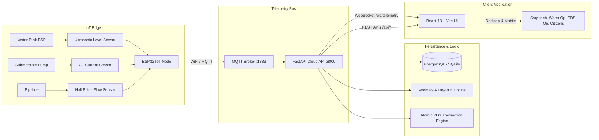

# Smart Water, Stronger Villages
> **Smart Monitoring. Faster Maintenance. Reliable Water. Transparent Distribution.**

An integrated, modern, and production-grade digital governance platform built for rural infrastructure monitoring (Drinking Water IoT & Digital O&M) and Public Distribution System (PDS) food grain management across Gram Panchayats.

---

## 1. System Overview

The **Smart Water & Digital Gram Panchayat Platform** bridges physical village infrastructure with transparent digital governance through one unified cloud portal:

1. **Smart Water Monitoring**: Real-time ultrasonic water tank leveling, submersible/centrifugal pump current consumption telemetry (CT sensor), abnormal dry-run anomaly alerts, and distribution flow monitoring.
2. **Digital Operations & Maintenance (O&M)**: Work order lifecycle (`Sensor Alert → Task Assignment → Field Inspection → Repair → Audit Closure`) and citizen grievance ticketing.
3. **Public Distribution System (PDS)**: NFSA-compliant beneficiary ration management with rapid card verification, monthly quota limits, atomic transactions preventing negative warehouse inventory, printable receipt slips, and physical stock reconciliation mismatch audits.
4. **Hardware Simulation Engine**: Virtual ESP32 IoT nodes emitting live telemetry over WebSockets with 6 pre-configured fault scenarios (Normal, Low Tank, Dry Run, Overload Trip, Pipeline Leakage, Sensor Offline) and manual calibration sliders.
5. **Multilingual Support**: Real-time localized interface across **English**, **मराठी (Marathi)**, and **हिंदी (Hindi)**.

---

## 2. Technology Stack

- **Frontend**: React 18, Vite, TypeScript, Tailwind CSS, Recharts (analytics & level graphs), Lucide Icons, React Router 6.
- **Backend**: Python FastAPI, SQLAlchemy ORM, Pydantic, WebSockets for live telemetry push, standard RFC 7519 JWT auth.
- **Database**: PostgreSQL (Production) / SQLite WAL mode (zero-setup self-contained local development).
- **IoT & Telemetry**: ESP32 microcontroller architecture, MQTT broker (HiveMQ / Mosquitto), non-invasive CT sensors, ultrasonic level sensors, pulse flow meters.
- **Deployment**: Docker, Docker Compose, Nginx.

---

## 3. Pre-configured Demo Accounts & Roles

All accounts share the default password: **`password123`**.  
The Login page also features a **One-Click Demo Switcher** that logs in with any role in a single click:

| Role | Full Name | Email | Jurisdiction / Scope |
| :--- | :--- | :--- | :--- |
| **Super Admin** | Dr. Rajeshwar Deshmukh | `superadmin@smartpanchayat.gov.in` | Universal access across all villages, system configuration, audit logs |
| **Gram Panchayat Admin** | Sarpanch Sunita Tai Patil | `gpadmin@smartpanchayat.gov.in` | Shivajinagar Gram Panchayat oversight, O&M approvals, reports |
| **Water Operator** | Ganesh Maruti Shinde | `waterop@smartpanchayat.gov.in` | Pump stations, water reservoirs, O&M field inspections |
| **PDS Operator** | Vilas Namdeo Jadhav | `pdsop@smartpanchayat.gov.in` | Fair price shop grain distribution, stock ledger, reconciliation |
| **District Officer** | Amit Kumar Sharma (IAS) | `districtofficer@smartpanchayat.gov.in` | District collectorate comparative analytics and deficit auditing |
| **Citizen / Beneficiary**| Anandrao Tukaram Kadam | `citizen@smartpanchayat.gov.in` | Personal ration entitlement lookup, citizen grievance filing |

---

## 4. Implemented Application Pages (22 Pages)

1. **Home / Landing Page (`/`)**: Hero with live telemetry overlays, automatic 6-slide rural photography carousel with hover-pause, primary module overview cards, interactive architecture flow, demonstration impact statistics, sample stakeholder testimonials, footer.
2. **Login Page (`/login`)**: Secure credential login with prefilled one-click demo login cards for all 6 roles.
3. **Overview Dashboard (`/app/overview`)**: High-level KPI cards, live reservoir cards, pump current draw, godown inventory summary, and quick links.
4. **Water Monitoring Dashboard (`/app/water`)**: Live reservoir storage cards with animated fluid levels, percentage, volume in litres, status classification, and flow rate.
5. **Individual Tank Details (`/app/water/tank/:tankId`)**: Deep-dive into reservoir dimensions, live fluid SVG visual, 24-hour historical Recharts telemetry trend, linked pumps, and connected sensors.
6. **Pump Monitoring Page (`/app/pumps`)**: Motor current draw (amperes), daily runtime, start counts, automated dry-run warning flags (<6.5A on active pump), and manual relay toggle.
7. **Hardware Simulation (`/app/simulation`)**: Start/Pause/Reset controls, 0.5x–5x speed slider, 6 predefined scenario injections, manual sensor adjustment sliders, ESP32 device node panel, and live telemetry log.
8. **Digital O&M Tasks (`/app/maintenance`)**: Work order directory, status filter (Open, Assigned, In Progress, Completed, Overdue), priority tags, and work order creation modal.
9. **Maintenance Task Details (`/app/maintenance/task/:taskId`)**: Detailed asset inspection view, technician notes input, status progression, and completion timestamp.
10. **PDS Dashboard (`/app/pds`)**: Registered beneficiaries summary, today's dispatches, low-stock threshold warnings, and commodity distribution bar charts.
11. **Beneficiaries Directory (`/app/beneficiaries`)**: Searchable directory, filter by card category (AAY Antyodaya, PHH BPL, APL), new beneficiary registration modal, and CSV export.
12. **Beneficiary Profile (`/app/beneficiaries/:id`)**: Household details, Aadhaar linkage status, monthly quota progress bars (consumed vs remaining), and distribution history.
13. **Ration Distribution Desk (`/app/distribution`)**: Rapid operator checkout: search card number, verify eligibility, check remaining quota vs available stock, atomic checkout, and printable transaction slip.
14. **Stock Management (`/app/stock`)**: Warehouse godown ledger, safety stock thresholds, and incoming Goods Receipt Note (GRN) form.
15. **Stock Reconciliation (`/app/reconciliation`)**: Automated audit formula (`Expected = Opening + Received - Distributed`), physical weighment entry, mismatch detection, and mandatory explanation audit log.
16. **Transaction History (`/app/transactions`)**: Historical distribution receipts ledger with search, CSV export, and printable transaction slips.
17. **Alerts & Notifications (`/app/alerts`)**: Central notification hub with severity filters (Critical, Warning, Info), acknowledge and resolve actions.
18. **Citizen Complaints (`/app/complaints`)**: Grievance lodging form (water supply interruption, pump failure, leakage, pressure, PDS), tracking status, and resolution notes.
19. **Reports & Analytics (`/app/reports`)**: Water supply audits, pump runtime logs, PDS stock ledgers, CSV export, and print-ready formats.
20. **Administration Panel (`/app/admin`)**: Jurisdictional village mapping, RBAC user directory, and immutable audit logs.
21. **Multilingual User Guide (`/app/guide`)**: 6-chapter interactive digital guide in English, Marathi, and Hindi with step-by-step walkthroughs and troubleshooting.
22. **User Profile (`/app/profile`)**: User information, role permissions matrix, jurisdiction assignment, and sign out.

---

## 5. End-to-End System Architecture



---

## 6. Setup & Local Launch Instructions

### Prerequisites
- Python 3.10+
- Node.js 18+

### Step 1: Backend Setup
```bash
cd backend
python -m pip install -r requirements.txt

# Run initial database seed (creates 4 villages, 6 accounts, 65 beneficiaries, water tanks, sensors)
python -m app.db.seed

# Start FastAPI server on port 8000
python -m uvicorn app.main:app --host 0.0.0.0 --port 8000 --reload
```
API Documentation will be live at: **`http://localhost:8000/docs`**

### Step 2: Frontend Setup
```bash
cd frontend
# (Dependencies are already installed in node_modules)
# Run Vite development server
node_modules\.bin\vite.cmd
```
Open your browser at: **`http://localhost:5173`**

---

## 7. Docker Deployment

To launch the full production stack with PostgreSQL 15, Eclipse Mosquitto MQTT, FastAPI, and Nginx:

```bash
docker compose up -d --build
```
- Web Application: `http://localhost:5173`
- API & Docs: `http://localhost:8000/docs`
- MQTT Broker: `localhost:1883`
- PostgreSQL: `localhost:5432`

---

## 8. Physical Hardware Integration (ESP32)

Physical hardware can directly publish telemetry to the platform without code changes.  
The C++ Arduino firmware sketch is provided at:
`firmware/esp32_smart_water_node.ino`

### Pin Configuration
- **Ultrasonic Trigger**: GPIO 5
- **Ultrasonic Echo**: GPIO 18
- **CT Current Sensor**: GPIO 34 (ADC1)
- **Flow Meter Pulse Interrupt**: GPIO 19
- **Pump Control Relay**: GPIO 23

### MQTT Telemetry Topic:
`smartpanchayat/v1/shiva/node1/telemetry`

### JSON Payload Schema:
```json
{
  "device_uid": "ESP32-NODE-01-SHIVA",
  "ip": "192.168.1.101",
  "water": {
    "tank_id": "tank-01",
    "level_pct": 72.4
  },
  "pump": {
    "pump_id": "pump-01",
    "current_amperes": 13.8,
    "is_running": true
  },
  "flow": {
    "flow_rate_lpm": 145.0
  }
}
```

---

## 9. Verification & Acceptance Test Matrix

| # | Acceptance Test | Implementation Evidence | Status |
| :-: | :--- | :--- | :-: |
| 1 | Multi-role login with RBAC | 6 seeded accounts across Super Admin, GP Admin, Water Op, PDS Op, District Officer, Citizen | Passed |
| 2 | Route & permission gating | Protected routes and permission matrix displayed in `/app/profile` | Passed |
| 3 | Dynamic tank fluid visual | Real-time SVG fluid level, percentage, volume in Litres, and status color coding | Passed |
| 4 | Abnormal pump current warning | Detection when pump is ON with current <6.5A (Dry Run Warning) or >16.5A (Overload) | Passed |
| 5 | Persistent database storage | Normalized tables with foreign keys and time-series sensor readings | Passed |
| 6 | Digital O&M workflow | Task creation, status progression (`OPEN -> IN_PROGRESS -> COMPLETED`), and inspection notes | Passed |
| 7 | Beneficiary management | Directory search, category filters (AAY/PHH/APL), modal registration, and CSV export | Passed |
| 8 | Rapid card verification | Instant eligibility calculation, remaining monthly quota, and warehouse stock cross-reference | Passed |
| 9 | Atomic PDS distribution | Atomic transaction checkouts, automatic stock decrement, and printable transaction slips | Passed |
| 10 | Monthly quota enforcement | Validation blocks requests exceeding remaining monthly entitlement | Passed |
| 11 | Negative stock prevention | Validation blocks requests exceeding available godown inventory | Passed |
| 12 | Physical stock reconciliation | Automatic formula check (`Expected = Opening + Received - Distributed`) and mismatch alerts | Passed |
| 13 | Audit trail logging | Critical actions recorded with timestamp, operator, and IP address | Passed |
| 14 | Real database charts | Recharts 24-hour water level trend and commodity inventory comparison | Passed |
| 15 | Report exports | Printable reports and CSV file downloads | Passed |
| 16 | Multilingual support | English, Marathi (मराठी), and Hindi (हिंदी) dictionary across all pages | Passed |
| 17 | Dark and light themes | Complete theme switching persisted in `localStorage` across all 22 pages | Passed |
| 18 | Hero image slideshow | 6-slide automatic photography carousel with hover-pause and manual navigation | Passed |
| 19 | Multilingual user guide | 6-chapter comprehensive walkthrough with troubleshooting and step-by-step tutorials | Passed |
| 20 | Mobile responsiveness | Responsive flex and grid layouts designed for smartphones, tablets, and desktops | Passed |

---
*Developed for Digital Public Infrastructure (DPI) & Rural Water Governance.*
